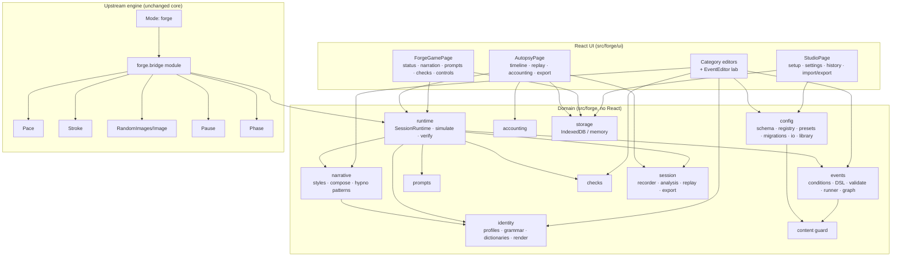

# B. Architecture and implementation plan

The fork adds a framework-independent domain layer, `src/forge/`, to the upstream app. It plugs in through a
single upstream extension point, a new engine **Mode** (`src/game/plugins/forge.ts`). Classic mode still
works unchanged.



## Modules

| Module | Responsibility | Main interface |
|---|---|---|
| `core/validate` | Dependency-free validator combinators with TypeScript inference and path-based errors. They reject `__proto__` keys. | `v.object`, `v.discriminated`, `validate()`, `Infer<>` |
| `core/rng` | Serialisable seeded RNG (mulberry32). Its state is `{seed, cursor, draws}`. | `Rng.next/int/weighted/pick` |
| `core/template` | Tokenised templates such as `{Token:arg}`, with casing. There is no expression evaluation. | `renderTemplate()` |
| `content/guard` | A fixed list of petplay, animal-role and pet-command terms, plus user-added terms. It normalises leetspeak and diacritics. | `scanText`, `scanValue` |
| `identity/*` | Identity profiles, pronoun sets, independent anatomy profiles, dictionaries with explicit inheritance, verb agreement, rendering, preview and lint. | `narrate(template, ctx)`, `previewIdentity`, `lintIdentity` |
| `narrative/*` | 18 composable styles: weight × strength, intensity windows, activation conditions, incompatibility suppression, excluded phrases and transitions. Also 12 hypnosis-inspired patterns. | `composeLine`, `hypnoLine`, `checkStyleMix` |
| `events/conditions` + `dsl` | JSON condition trees and a hand-written restricted DSL parser and formatter. | `evaluate`, `parseCondition`, `formatCondition` |
| `events/validate` | Schema check, DSL compile, duplicate ids, invalid references, unreachable events, unbounded cycles (Tarjan SCC), contradictions, excluded terms and version checks. | `compilePack()` → `{ok, pack, errors, warnings}` |
| `events/runner` | A **pure** interpreter: `(pack, options, state, input) → (state, effects, log)`. Strategies are weighted, dice, sequential and shuffle. | `engineTick`, `engineTrigger`, `ineligibleReason` |
| `prompts`, `checks` | Prompt templates, triggers and response validation (length, vocabulary, perspective). Checks have schedules, responses and explicit statistics. | `validateResponse`, `dueCheck`, `previewSchedule` |
| `accounting` | Facts and user rules, with explanations, caps, weights, annotations and adjustments. Safety records are excluded. | `computeAccounting` |
| `session/*` | An append-only recorder with stable ids. Analysis covers curves, filters and autopsy. Replay offers a log cursor and a ghost overlay. Export is JSON/CSV with redaction. | `SessionRecorder`, `autopsy`, `ReplayCursor`, `ghostAt`, `exportJson` |
| `config/*` | Versioned `ForgeConfig`; user items layer over built-ins by id. The category registry handles reset, search and unsaved markers. Also presets, migrations, and one import entry point. | `compileConfig`, `registerCategory`, `resetCategory`, `applyPreset`, `importDocument` |
| `runtime/runtime` | `SessionRuntime` owns the clock, intensity, the engine, narration, prompts, checks, hypno, recording and the **safety contract**. | `tick(dt)`, `pause`, `resume`, `terminate`, `submitPrompt`, `answerCheck`, `view` |
| `runtime/simulate` | Dry runs, eligibility explanations and deterministic re-simulation (`verifyReplay`). | |
| `storage/store` | Local-only persistence: IndexedDB through `idb`, with an in-memory fallback. | `ForgeStore` |

## Event lifecycle

1. **Load.** The config is resolved by `resolveLibrary` (built-ins plus user overrides). `mergedPack` applies
   disabled events and weight overrides, and `compilePack` validates. If there are errors, the session still
   runs with events disabled, and the errors are logged and shown.
2. **Tick.** The host calls `runtime.tick(dt)`. Time is split into fixed 50 ms steps. Each step: check the
   duration limit, then scheduled breaks; if not paused, advance active time; warm-up→active; grow intensity
   (clamped to the ceiling); expire lines; time out prompts and checks; run the **engine tick**; then hypno and checks.
3. **Selection.** When idle, every `rollIntervalSeconds`, and after `minGapSeconds`, the engine collects
   eligible events. Eligibility covers enabled, selectable, weight > 0, phase, intensity window, identity, media
   tags, repeat limit, cooldown, no-repeat window and conditions. It then picks with the configured strategy.
4. **Execution.** Steps run until a `wait`, a ramp or countdown tick, or a blocking prompt/check is reached. The
   chain then continues with `goto`, `branch`, `next`, groups and sequences. A `loop` repeats up to its bound.
   `terminateIf` aborts. Guards cap the chain depth and the steps per tick; on overflow the chain is aborted
   and the session continues.
5. **Effects → runtime.** Effects are narrate, message, setPace, setPhase, grip, intensity, prompt, check, media,
   marker, climax and end. The runtime renders text through the identity and style layer, clamps values, opens
   prompts and checks, and records everything.
6. **Logging.** Every engine log entry and every applied effect becomes a `SessionEvent`. User actions are recorded
   with their wall time on step boundaries.
7. **End.** A climax or `end` step, user termination, or the duration limit ends the session. The record is saved
   locally only if recording is enabled.

## Configuration, execution, logging and replay

```
ForgeConfig ──compileConfig──▶ CompiledPack + Library
     │                                │
     └── embedded snapshot ──┐        ▼
                             │  SessionRuntime(seed) ──▶ SessionRecord (events, replay meta)
                             │        ▲  user actions        │
                             └────────┴───── verifyReplay ◀──┘   (re-run + compare)
                                                     ReplayCursor / ghostAt (log only)
```

## Safety architecture

The safety controls sit **outside** the event engine, so scripts cannot reach them.

- The engine's effect vocabulary has no pause, resume, stop, lock or "disable controls" effect.
- `terminate()` always ends the session at once. It closes any open prompt or check, and every later call is a no-op.
- `pause()` freezes active time. Only the user can resume. Safety pauses never open prompts.
- Intensity is clamped to `min(safety ceiling, identity max)`, and the user can lower the ceiling live.
- The duration limit counts wall-clock time, so it applies even while paused.
- Prompts and checks can be skipped or turned off at any time, including "required" ones. A negative check
  answer triggers an event **only** when the user configured `onNegativeEvent`.
- Accounting never counts termination or emergency stops. Safety pauses are excluded unless the user opts in.
- Logs never leave the browser except through an explicit export, which shows a preview and defaults to redaction.

## Integration with the upstream engine

`forge.mode` registers the `forge` Mode. In that mode it loads the upstream Clock, Pace, Stroke, RandomImages
and Cues modules plus `forge.bridge`. It does **not** load Intensity, Hypno, Dealer, Warmup or EmergencyStop. On
every engine tick the bridge does the following:

- syncs pause **edge-triggered** in both directions: Esc or the pause menu pauses the runtime, and a runtime
  pause, break or end pauses the engine;
- calls `runtime.tick(step)`;
- mirrors pace, phase and intensity into the frame, so the meter, slideshow, toys and cues follow;
- forwards the current media id;
- publishes `runtime.view` for React.

## Increment plan (as delivered)

1. Fork, install, check the baseline (376 upstream tests green).
2. Core: validator, RNG, templates, guard, then identity and dictionaries.
3. Narrative styles, hypno patterns, conditions and DSL.
4. Event engine: schema, validation, runner and the default pack.
5. Prompts, checks, accounting, session log, analysis, replay and export.
6. Config registry, presets, migrations, import/export, storage and runtime.
7. Bridge plugin, Studio UI, session page, autopsy page, and petplay removal.
8. Docs, full verification (tests, lint, build, end-to-end browser run).
