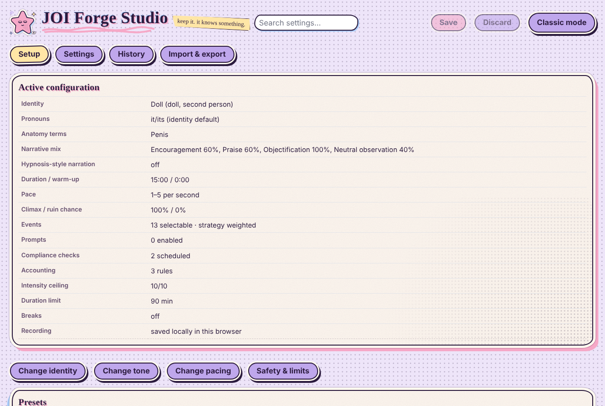
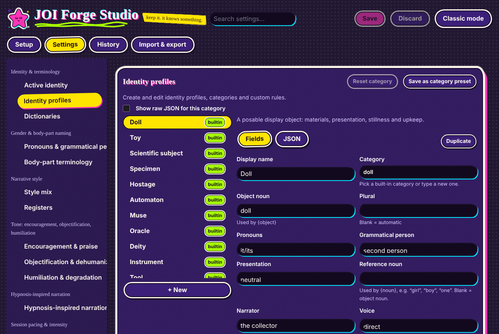
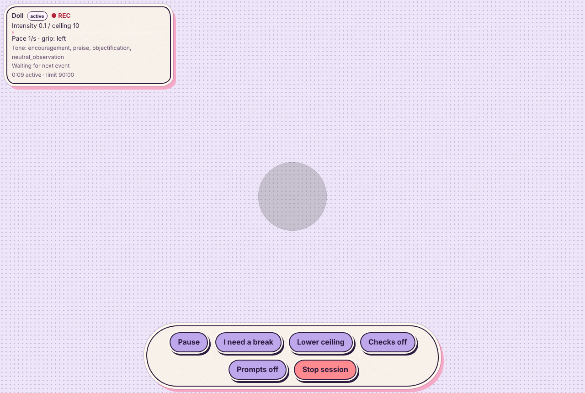
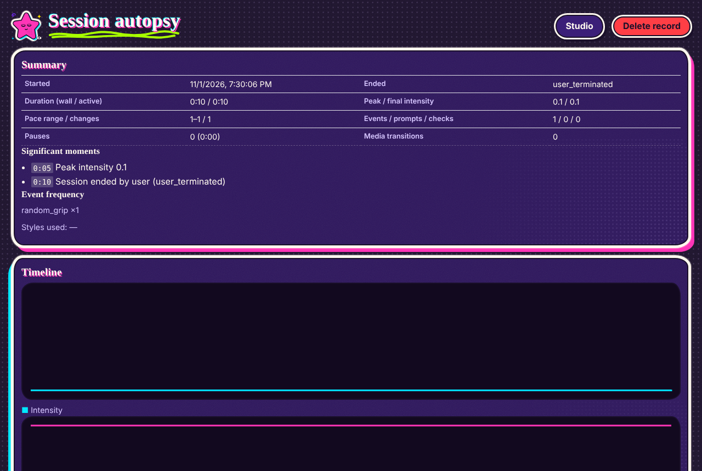

# J. Sticker World UI theme

The Forge UI follows the **Universal Sticker World Style Bible — Crayon Core + Dry-Flow Material Edition
v2.0**. It is the default look of the Studio, the session page and the session autopsy. Classic mode (`/`)
keeps the original joi.how styling.

Switch it under **Settings › Appearance & accessibility › Theme**:

| Theme | Bible palette mode |
|---|---|
| Sticker · Pastel Cloud *(default)* | §5 Pastel Cloud: soft, dreamy, collectible |
| Sticker · Neon Riot | §5 Neon Riot: flat neon on midnight-grape paper |
| Midnight (original dark) | The previous Forge look, with no sticker treatment |

| Pastel Cloud — setup | Neon Riot — identity editor |
|---|---|
|  |  |
| **Pastel Cloud — active session** | **Neon Riot — session autopsy** |
|  |  |

## Where things live

| File | Role |
|---|---|
| `src/forge/ui/theme-sticker.css` | All theme rules. **Both palettes are token blocks at the top.** Change the hex values there to retune everything. |
| `src/forge/ui/StickerEmblem.tsx` | The original emblem: a puffy sleepy star sticker with story debris. |
| `src/forge/config/schema.ts` | `accessibility.theme`: `'pastel-cloud' \| 'neon-riot' \| 'midnight'`, default `'pastel-cloud'`. Older configs without the field get the default, so no migration is needed. |
| `src/forge/ui/forgeConfigState.ts` | `rootClass()` adds `sticker theme-<mode>` to the Forge root. |

## How the bible maps to the UI

| Bible anchor | UI implementation |
|---|---|
| **Die-cut border** (§2, border rule) | Every card, dialog, overlay and button gets a grape-ink contour (`border`), then a thick warm-milk `#FFF9EF` ring (`box-shadow` spread, so it follows the rounded silhouette), then a faint cut edge. It is never a thin keyline. |
| **Wobbly ink** | Asymmetric "hand-cut" radii (`--wobble-a/b/c`, `--pill`) that vary by position, so no two neighbouring stickers share a perfectly even outline. |
| **Puffy shape language** | Pill buttons, pillowy cards, no sharp corners. Buttons press down on click. |
| **Printed surface** | A crayon-grain layer (inline SVG noise) on paper and stickers, plus a halftone shadow cluster in one corner of each card. No gradients or airbrushing. |
| **Line hierarchy** (§4) | The outer contour is heaviest (2.5 px). Fields use 2 px. Table rules are light crayon dashes. |
| **Colour system** (§5) | Exact bible hex values. Dark grape ink stands in for black. Neon Riot keeps dark paper as breathing room and uses neon only as flat fills and accents, with no glow or blur. |
| **Crayon Core budget** (§3.2) | **One dominant interruption**: an off-register print echo (a coloured offset shadow on cards and buttons, and misregistered heading lettering). **Two support marks**: a scribbled crayon underline under page titles, and one taped margin note ("keep it. it knows something."). Nothing else, so controls stay the focal read. |
| **Expressive charge + story debris** (§2, §10) | The header emblem is a puffy star with heavy-lidded sleepy eyes and a blunt mouth. It is orbited by 4 debris pieces (two sparkles, an eye charm, a spiral), uses a cyan off-register echo and a halftone shadow, and every symbol is original. |
| **Text** (§3.1) | Hand-lettered headings, short and readable. Body text stays a rounded sans for legibility. |
| **Wetness control** (§7–8) | Nothing in a UI is liquid, so there are no drips anywhere. The dry-flow doctrine has no UI surface to apply to (there is no hair or fur). |
| **Readability check** (§12) | Values were chosen for contrast. Ink on milk and milk on indigo are both well above WCAG AA, and Pastel muted text is a darkened mauve (`#66506F`) rather than the raw shadow partner, which is too light for small text. |

### Session page

Narration lines are speech-bubble stickers that alternate echo colour and get a slight hand-placed tilt. Hypno
words use chunky die-cut lettering with a flat two-colour misregistration. The status panel and the always-on
control bar are stickers too; **Stop session** is the red sticker.

## Accessibility

- **Reduced motion** (system setting, or forced on in Forge) removes every tilt and hover wobble.
- **High contrast** keeps the sticker shapes but removes grain, halftone and tints, and switches to pure black/white text.
- Focus is a 3 px dashed ultraviolet ring (acid yellow in Neon Riot), offset outside the die-cut border.

## Known limits

- The hand-lettered heading font is a system font stack: Marker Felt, Chalkboard SE, Comic Neue or Comic Sans
  MS, falling back to the system cursive font. No web font is downloaded, which keeps the app offline-capable
  and avoids a third-party request. On machines without those fonts, headings fall back to the default cursive
  font; the headless Linux browser used for the screenshots rendered them as serif.
- The stroke meter and slideshow come from upstream and keep their original styling.
- The emblem is the only illustration. The bible's character, creature and material rules (dry flow, drips,
  category translators) describe illustrated assets, which this UI does not contain.
